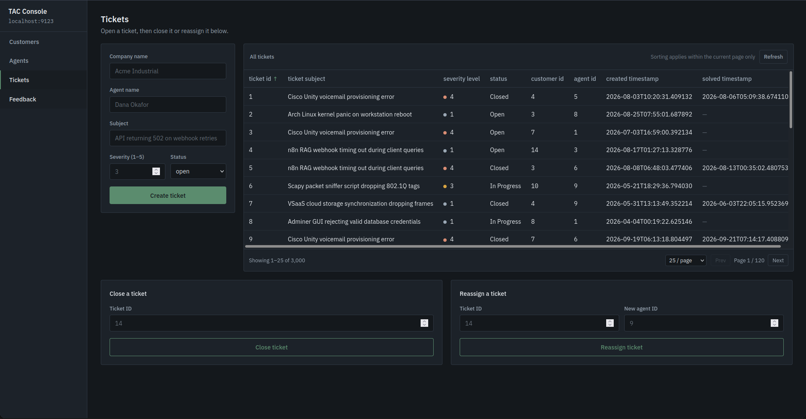

# TAC Console: Technical Assistance Center Ticketing Backend

A support-ticketing system for a Technical Assistance Center (TAC). It tracks **customers**, **support agents** (with skills and locations), **tickets**, and **customer feedback**, and ships with a built-in web console so everything can be used from the browser.

Built with **FastAPI**, **PostgreSQL**, and **Docker Compose**. The key business rules (closed tickets are immutable, every status/severity change is audited) are enforced **inside the database** with triggers, not just in application code.




---

## Table of Contents

1. [Features](#features)
2. [Tech Stack](#tech-stack)
3. [Architecture](#architecture)
4. [Quick Start](#quick-start)
5. [API](#api)
6. [Database Design](#database-design)
7. [Design Decisions](#design-decisions)
8. [Known Limitations and Roadmap](#known-limitations-and-roadmap)
9. [License](#license)

---

## Features

- **Customers and agents:** register companies with an account tier, and create agents with a technical tier, a location, and any number of skills, all in one atomic transaction.
- **Ticket lifecycle:** open tickets against a customer and an agent, reassign them, and close them (the solve timestamp is set automatically).
- **Customer feedback:** a 1-5 rating plus an optional comment, one entry per ticket.
- **Rules enforced by the database:** a closed ticket cannot be modified, and every change to a ticket's status or severity is written to an audit log.
- **Web console:** a responsive single-page UI served by the API itself, with search, sorting, and pagination. No separate frontend server and no CORS setup.
- **Interactive API docs:** Swagger UI at `/docs`, generated by FastAPI.
- **Realistic seed data:** 3,000 tickets, 15 customers, 10 agents, and up to 1,000 feedback entries, generated by pure SQL.

---

## Tech Stack

| Layer | Technology |
|---|---|
| API | FastAPI, Pydantic v2, Uvicorn |
| Database | PostgreSQL (raw parameterized SQL through psycopg2, no ORM) |
| Frontend | HTML, vanilla JavaScript, Tailwind CSS (single file, no build step) |
| Packaging | Docker and Docker Compose |

---

## Architecture

```text
Browser (index.html: Tailwind + vanilla JS)
   |
   |  HTTP / JSON
   v
Docker Compose
 +- api container :9123
 |    main.py          FastAPI routes + Pydantic models
 |    tac_backend.py   all SQL, commit / rollback
 |         |
 |         |  TCP 5432 (host "db")
 |         v
 +- db container :5432
      PostgreSQL: tables, indexes, triggers
```

The code is split into three layers:

1. **`main.py`** is the HTTP layer. It defines routes, validates request bodies, and turns results into HTTP responses. It also serves the console at `/`.
2. **`tac_backend.py`** is the data layer. It holds every SQL statement and handles transactions: commit on success, rollback on failure.
3. **PostgreSQL** owns data integrity: foreign keys, uniqueness, and triggers.

Project layout:

```text
main.py            FastAPI app: routes and request models
tac_backend.py     database layer
index.html         web console
Tables.sql         schema: tables, indexes, triggers
DummyData.sql      seed script
Dockerfile         API image
compose.yaml       api + db services
```

---

## Quick Start

**Prerequisites:** [Docker](https://docs.docker.com/get-docker/) with Compose, and Git. You do not need Python or PostgreSQL installed locally. Ports `9123` and `5432` must be free.

```bash
# 1. Clone and start everything
git clone https://github.com/SateHad/tac-ticketing-backend.git
cd tac-ticketing-backend
docker compose up --build -d

# 2. Create the tables (the database starts empty)
docker compose cp Tables.sql db:/tmp/Tables.sql
docker compose exec db psql -U postgres -d postgres -v ON_ERROR_STOP=1 -f /tmp/Tables.sql

# 3. Optional: load the sample data
docker compose cp DummyData.sql db:/tmp/DummyData.sql
docker compose exec db psql -U postgres -d postgres -v ON_ERROR_STOP=1 -f /tmp/DummyData.sql
```

> `DummyData.sql` starts with `TRUNCATE ... CASCADE` and **deletes all existing data**. Only run it on a database you are happy to reset.

Then open:

| What | URL |
|---|---|
| Web console | <http://localhost:9123> |
| Swagger UI | <http://localhost:9123/docs> |

**Everyday commands**

| Task | Command |
|---|---|
| Stop, keep data | `docker compose down` |
| Stop and delete all data | `docker compose down -v` |
| Rebuild after code changes | `docker compose up --build -d` |
| API logs | `docker compose logs -f api` |

**Common issues**

- **`api` restarts once or twice on first boot:** PostgreSQL was not ready yet. Wait a few seconds; `restart: always` handles it.
- **`relation "customers" does not exist`:** the schema was not loaded. Run step 2.
- **`already exists` when loading `Tables.sql`:** it is not idempotent. Reset with `docker compose down -v` and start again.
- **`500 Database failed`:** the real reason is in `docker compose logs api` (usually a name that does not match exactly, or an edit to a closed ticket).

---

## API

All bodies are JSON. Full interactive documentation is at `/docs`.

| Method | Path | Purpose |
|---|---|---|
| `POST` | `/customers/` | Create a customer |
| `POST` | `/agent/` | Create an agent with skills |
| `POST` | `/ticket/` | Create a ticket (by company name and agent name) |
| `PUT` | `/ticket/{id}/closing/` | Close a ticket |
| `PUT` | `/ticket/{id}/change/` | Reassign a ticket to another agent |
| `POST` | `/feedback/` | Add feedback (one per ticket) |
| `GET` | `/customers/query/`, `/agents/query/` | List all customers or agents |
| `GET` | `/tickets/page/`, `/feedback/page/` | Paginated lists (`limit` 1-100, `offset` 0 or more) |

Example: create a customer, then fetch a page of tickets.

```bash
curl -X POST http://localhost:9123/customers/ \
  -H "Content-Type: application/json" \
  -d '{"company_name": "Acme Industrial", "account_tier": 1,
       "contact_email": "ops@acme.com", "company_phone_number": "+962790000000"}'

curl "http://localhost:9123/tickets/page/?limit=10&offset=20"
```

Invalid input is rejected with `422`. Database failures return `500` (see [limitations](#known-limitations-and-roadmap)).

---

## Database Design

| Table | Purpose |
|---|---|
| `locations` | Where agents work (city, country, timezone) |
| `customers` | Companies that raise tickets |
| `skills` | Skill catalogue |
| `tac` | Support agents (the "TAC staff" table) |
| `agent_skills` | Many-to-many link between agents and skills, with a composite primary key so a skill cannot be assigned twice |
| `tickets` | The core table: customer, agent, subject, severity, status, created and solved timestamps |
| `ticket_feedback` | One rating per ticket, enforced with a `UNIQUE` constraint on `ticket_id` |
| `ticket_audit_log` | Automatic history of status and severity changes |

Foreign-key columns and the common filter columns (`status`, `severity_level`, `customer_id`, `agent_id`) are indexed.

**Triggers: business rules inside the database**

- **`closed_ticket_protection`** (`BEFORE UPDATE` on `tickets`): raises an exception if the old row is already `Closed`, so closed tickets can never be modified.
- **`trigger_audit_ticket`** (`AFTER UPDATE` on `tickets`): writes a row to `ticket_audit_log` whenever `status` or `severity_level` changes.

When a ticket is closed, the two cooperate: the BEFORE trigger sees the old row is not closed yet and lets the update through, then the AFTER trigger records `Open -> Closed`. Any later update to that row is rejected and rolled back.

```sql
-- Try it: this fails with "Cannot modify a closed ticket"
UPDATE tickets SET severity_level = 5
WHERE ticket_id = (SELECT ticket_id FROM tickets WHERE status = 'Closed' LIMIT 1);
```

---

## Design Decisions

- **Raw SQL with psycopg2, no ORM:** full control over queries, transactions, and triggers, and a clear view of what actually runs against the database.
- **Parameterized queries everywhere:** values are never string-formatted into SQL, which prevents SQL injection.
- **Rules in the database:** closed-ticket immutability and the audit trail hold no matter which client writes (this API, a script, or a SQL shell).
- **Transactions with rollback:** multi-step writes such as creating an agent with skills are all-or-nothing.
- **Two pagination strategies:** small tables are sent whole and searched in the browser; the 3,000+ row tables use `limit`/`offset` with a deterministic `ORDER BY`.
- **UI served by the API:** one origin and one port, so there is no CORS and only one container to deploy.

---

## Known Limitations and Roadmap

This is a learning project, and I have documented its rough edges openly. They are also my to-do list.

- **Errors collapse to `500`:** the broad `except` in `main.py` also catches the `404` raised just above it. Fix: re-raise `HTTPException` and return distinct errors for not-found, conflict, and real database failures.
- **Status values are inconsistent:** the database logic expects `Open`, `In Progress`, `Closed`, but the console dropdown sends lowercase values. Fix: one canonical set, enforced with a `CHECK` constraint.
- **Weak input validation:** severity and rating ranges are enforced only by the UI. Add Pydantic `Field(ge=1, le=5)` and SQL `CHECK` constraints.
- **Tickets are created by company and agent name**, which are not unique. Switch to IDs.
- **One shared database connection** for all requests. Move to a connection pool.
- **Hard-coded credentials and no authentication.** Move secrets to environment variables and add auth before any real deployment.
- **Schema is not loaded automatically.** Mount the SQL files into `/docker-entrypoint-initdb.d/` or adopt migrations (Alembic), and add a healthcheck so the API waits for PostgreSQL.
- **Tests and CI:** add `pytest` with FastAPI's `TestClient` and a GitHub Actions workflow.

---

## License

Released under the [MIT License](https://github.com/SateHad/tac-ticketing-backend/blob/main/LICENSE).

---

Built by **Sate Haddadin** as a first backend project. Feedback is welcome: open an issue or reach out via [GitHub](https://github.com/SateHad).
